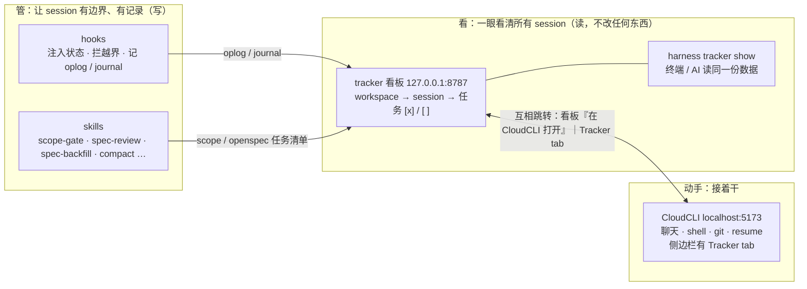

# agent-harness

**运维本地 agent 的工具箱。** 同时开着十几个 Claude Code session 时，它做三件事：让每个 session 有边界、有记录（**管**），让你一眼看到谁在等你、任务做到哪了（**看**），以及在浏览器里接着干（**动手**）。全局装一次，在任意 workspace 生效，行为由项目目录里的 `.harness/` 决定。

设计原理见 [DESIGN.md](DESIGN.md)。一句话版本：**必须发生的事挂在 hook 上，需要判断的事做成主动触发的 skill；写入不做判断，判断延迟到压缩。**

## 全貌：管、看、动手



| 我想… | 去哪 | 怎么开 |
|---|---|---|
| 看所有 session：谁在等我、任务做到哪、还剩哪些 | tracker 看板 | `bin/harness tracker` → <http://127.0.0.1:8787> |
| 接着某个 session 干：聊天、开 shell、看 git | CloudCLI | <http://localhost:5173>；看板里每个 session 有「在 CloudCLI 打开」按钮 |
| 在 CloudCLI 里直接看当前 session 的任务和子任务完成情况 | Tracker tab | CloudCLI 侧边栏 → Tracker（`bin/harness install` 自动安装插件） |
| 在终端里看，或者让 AI 看全局 | `tracker show` | `bin/harness tracker show [workspace]` |
| 重建某个 session 的来龙去脉（做了什么、卡在哪、怎么续跑） | tracker 看板 / Tracker tab | 选中 session → Session Summary 框 → 点按钮 |
| 某个 session 没走流程，事后补 spec | skill | `/harness-spec-backfill` |
| 体检：hook / skill / 插件 / scope 格式 | doctor | `bin/harness doctor` |

CloudCLI 是独立的开源项目（[siteboon/claudecodeui](https://github.com/siteboon/claudecodeui)），需要另外装；本仓库只提供它的 **Tracker 插件**（`tracker/cloudcli/`），没装 CloudCLI 时看板照常可用。看板和 CloudCLI 的地址可以在 `~/.harness/config.yml` 的 `tracker:` 段修改（`port`、`cloudcli_url`）。看板的详细说明见 [tracker/README.md](tracker/README.md)。

## 装

```bash
/Users/rshao/work/context-infrastructure/projects/agent-harness/bin/harness install
/Users/rshao/work/context-infrastructure/projects/agent-harness/bin/harness doctor
```

`install` 做四件事，全部幂等：把 `hooks/*.py` 软链进 `~/.claude/hooks/`，把 `skills/*` 软链进 `~/.claude/skills/`，
把 `install/hooks-manifest.json` 的条目并进 `~/.claude/settings.json`（写之前先备份，只增不改别的），
在 `~/.harness/` 下建 journal 和 run 目录并放一份全局默认配置。

`doctor` 检查每一条软链是否指向这个仓库、settings.json 引用的文件是否真存在、目录是否齐全，并校验 `tracker.roots` 下所有 scope 文件（YAML 解析失败报 FAIL，字段问题报 WARN）。有 FAIL 时退出码非零，可以直接进 cron。

## 接一个项目

```bash
cd /path/to/repo
/Users/rshao/work/context-infrastructure/projects/agent-harness/bin/harness init
```

然后在那个仓库里跑 `/harness-onboard`，它会摸底、填 `project.yml` 的自主边界、从现有文档蒸馏第一版 `STATE.md`。

## 主动 skill + 一个被动引用的 skill

| skill | 什么时候用 | 干什么 |
|---|---|---|
| `/harness-onboard` | 接入一个新仓库 | 装 `.harness/`，定边界，蒸馏首版 STATE.md |
| `/harness-compact` | 状态乱了，或定时 | 收敛 STATE.md，归档过期内容，git 留痕 |
| `/context-observe` | 想知道这段时间干了什么，或定时 | 扫 git log / harness journal / Claude Code 记忆 / 手写日记，append 进 `.context/OBSERVATIONS.md`，不判断去留 |
| `/harness-explore` | 需要调查 | 拆正交维度并行派 subagent，结构化合并 |
| `/harness-dispatch` | 手上有一份【下一步】清单要执行 | 推 DoD 并确认一次，然后按依赖分波派 3-8 个子 agent 执行，主 agent 只调度与收口；DoD 逐条 verify 通过才停，子 agent 的线上写命令走 escrow 一波一批 |
| `/harness-scope-gate` | 中大型改动开工前 | 逐题问清楚目标/不做什么/验收标准/允许碰哪些路径，写成 `confirmed` 的 scope artifact——`harness-envelope.py` 只认这份 artifact 的 `covers` 字段，见 [docs/scope-and-spec-gate-design.md](docs/scope-and-spec-gate-design.md) |
| `/harness-spec-review` | 一个 scope 的改动做完之后 | 独立无上下文 reviewer 打分，有限轮次收敛到 `CLEARED`/`DONE_WITH_CONCERNS`。**纯 pull**——没有 hook 会替你发现"有 scope 没收敛"，得自己记得跑；不点名就只报告未收敛列表，不代别的 session 判定 |
| `/harness-req-split` | 大需求开工前 | 拆成 N 个能各自判 pass/fail 的子 scope，每个走一遍 scope-gate，起一份 pipeline artifact 串联后续阶段 |
| `/harness-cross-verify` | 子 scope 都收敛后 | 先证明维度正交，再拆多路无上下文 reviewer 交叉核查，主 agent 只合并找矛盾 |
| `/harness-scale-check` | 要在真实规模环境下验证时 | 最小可回退档位 → 逐档扩大 → 每档验证，证据记进 pipeline artifact |
| `/harness-spec-backfill` | 有没走流程的 session 要补登 | 从 transcript 倒推 spec 和每条 AC 的判定，草稿经确认后写成 `status: reconstructed` 的 scope。**草案**，见 [tracker/README.md](tracker/README.md) |
| `harness-output-format` | 不由用户主动触发 | 输出格式契约的唯一真相来源；`harness-session-start.py`/`harness-prompt-contract.py` 从这份文件读取正文注入 context，改这一处即可同时影响两个 hook；也可以在没有这套 hook 的地方手动引用保持格式一致 |

**`scope_gate` 是纯 opt-in（2026-08-14 撤销了默认全局强制）。** `protected_paths` 留空就完全不限制，不再回退到 `write_roots` 或整个仓库。原因：本地、git 跟踪的编辑本身就可回退，git 已经是安全网，用一个默认全仓库生效的确认闸门去挡每一次写操作，代价（几乎每次改动都要先跑 `/harness-scope-gate` 逐题澄清）远大于收益。实测反例：`cre6630-infra` 显式配置 `protected_paths` 覆盖了 6 个目录，两天内攒了 15 个 `confirmed` scope artifact，其中 11 个从未跑过 `/harness-spec-review` 收敛——多数是"为了解锁写权限"而不是真的需要提前澄清。想在特定路径上加额外摩擦（比如这套 harness 自己的自举文件），在 `project.yml` 里显式写 `scope_gate.protected_paths` 即可，不写就不生效。详见 `docs/scope-and-spec-gate-design.md` 的撤销记录。

## 六个 hook

| hook | 事件 | 作用 |
|---|---|---|
| `harness-session-start.py` | SessionStart | 注入 STATE.md、journal 尾部、自主边界、输出契约（读 `harness-output-format` skill） |
| `harness-prompt-contract.py` | UserPromptSubmit | 每轮回复前追加一句输出格式提醒，防止长 session 里 SessionStart 的注入被淡忘/压缩掉 |
| `harness-envelope.py` | PreToolUse | 安全区内直接放行，安全区外硬拦；外加 scope gate——写操作命中受保护路径且没有 `confirmed` scope artifact 覆盖，同样硬拦 |
| `harness-oplog.py` | PostToolUse | 变更留痕。journal 记「说了什么」，oplog 记「动了什么」，带 `# INTENT:` 和当时的 git ref；只读命令跳过 |
| `harness-journal.py` | Stop | 每轮无条件 append 一条 WAL 记录，不做判断 |
| `harness-stop-contract.py` | Stop | 只看这一轮自己的回复：在 envelope 内停下来征求同意时推回去一次；散文长回复兜底提醒（pre 机制失效时的最后一道）。**不扫项目状态**——曾经的 spec-review guard 会扫全仓库 scope 并拦下别的 session 开的活儿，已删除 |

除 journal 和 oplog 外，其余 guard 类 hook 每 session 最多各触发一次，不会循环。所有 hook 在没有配置的目录下静默返回。

## 项目目录长这样

```
<repo>/.harness/
├── project.yml          # 边界、权威入口、输出契约
├── STATE.md             # 当前有效的结论（compaction 的产物，session 开头自动注入）
├── journal/
│   └── 2026-08-08.jsonl # WAL，只增不改
├── oplog.jsonl          # 变更留痕：写了什么文件、移了什么、跑了什么 mutating 命令
├── scope/
│   └── <slug>.yml       # /harness-scope-gate 的产出，被 harness-envelope.py 检查 covers；review 段由 /harness-spec-review 写
├── backfill-drafts/     # /harness-spec-backfill 的草稿，确认后才进 scope/
├── pipeline/<slug>.yml  # /harness-req-split 的阶段串联（可选）
├── archive/
│   └── 2026-08-15/
│       ├── ARCHIVE-MANIFEST.md   # 每条：原路径 / 原因 / 被什么取代 / 时间
│       └── <被取代的文件>
└── .last-compact        # 上次收敛的时间戳
```

## 大盘：tracker

`.harness/` 的只读旁路：按 workspace → session 展示状态，任务清单来自 OpenSpec 的 `tasks.md`，没有 spec 的 session 标「无 spec」。入口：CloudCLI 里的 Tracker tab（主）、独立总览页 `127.0.0.1:8787`、`harness tracker show`（给 AI/终端）。

```bash
bin/harness tracker          # http://127.0.0.1:8787，只绑 loopback
bin/harness tracker show     # 终端/AI：markdown 输出，可加 workspace 名或 --json
bin/harness tracker scan     # 只重建 scope 快照
```

不写任何 scope，没有自动调 LLM 的路径（只有手动点「核对勾选」或「Session Summary」才调一次 sonnet）。运行时数据放在 `~/.harness/tracker/`，仓库里只有代码。
用法、workspace 怎么组织、配合哪些 skill、哪些部件能依赖，见 [tracker/README.md](tracker/README.md)；设计见 [docs/tracker-design.md](docs/tracker-design.md)。

## 定时收敛

```bash
echo /path/to/repo >> ~/.harness/projects.txt
# crontab
0 3 * * * /Users/rshao/work/context-infrastructure/projects/agent-harness/periodic/compact-cron.sh \
            --projects-file "$HOME/.harness/projects.txt" >> /tmp/harness-compact.log 2>&1
```

脚本自带三重守卫：没有 `.harness/` 跳过、距上次收敛不足 7 天跳过、工作区脏跳过。

## 洞察观测：`.context/`

`.harness/STATE.md` 回答「现在状态是什么」，会覆盖旧结论。`.context/OBSERVATIONS.md` 回答「这段时间发生过什么、
有什么值得沉淀的模式」，append-only，历史条目不删不改。两套机制独立，只装一个也行。

```bash
cd /path/to/repo
/Users/rshao/work/context-infrastructure/projects/agent-harness/bin/harness context-init .
```

生成 `.context/{project.yml,OBSERVATIONS.md,journal/}`。跑 `/context-observe` 做一次观测，
或挂定时：

```bash
echo /path/to/repo >> ~/.harness/context-projects.txt
0 21 * * * /Users/rshao/work/context-infrastructure/projects/agent-harness/periodic/context-observe-cron.sh \
            --projects-file "$HOME/.harness/context-projects.txt" >> /tmp/context-observe.log 2>&1
```

四路输入，缺一路自动跳过：`git log`、`.harness/journal/*.jsonl`（如果这个项目也接了 `.harness/`）、
Claude Code 的自动记忆目录（按 cwd 算 slug，见 `~/.claude/projects/<slug>/memory/`）、
`.context/journal/YYYY-MM-DD.md` 里的手写笔记。按🔴🟡🟢分级 append，同一天幂等。

**目前只做 L1 Observer（记录），还没有 L2 Reflector（晋升/GC）。** 攒够几轮真实数据、看清楚哪些 🔴
条目反复出现之后再补，现在补会是凭空设计。

## 拆

```bash
/Users/rshao/work/context-infrastructure/projects/agent-harness/bin/harness uninstall
```

移除软链和 settings.json 里的 harness 条目，项目目录里的 `.harness/` 保持不动。

## 和 context-infrastructure 的分工

`context-infrastructure` 管个人思想的归纳，跟着人走。这个仓库管工作项目的运行机制，跟着项目走。两者互不依赖。
