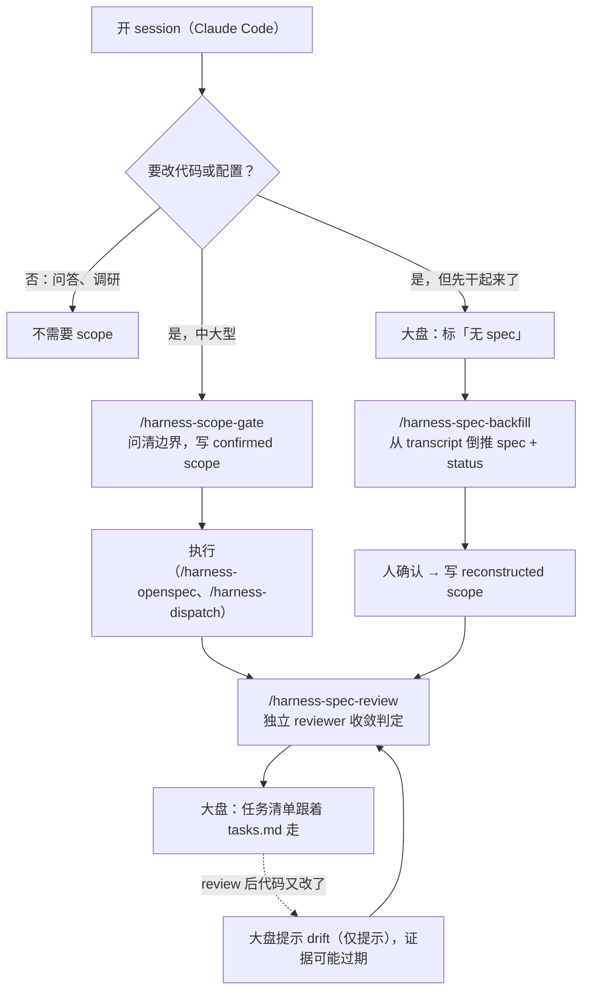

# harness tracker

`.harness/` 的**只读旁路大盘**，是「运维本地 agent 的工具箱」（见[仓库 README](../README.md)）里**看**的那一块：hooks 和 skills 负责写，tracker 只读，不做任何判断；要接着干，就跳到 **CloudCLI**。

它回答三个问题：

1. 每个 workspace 下有哪些 session，各在什么状态（要不要我介入）？
2. 每个 session 对应的任务做到哪了（任务清单来自 OpenSpec 的 `tasks.md`）？
3. 哪些 session 根本没有 spec？

它不是实时监控，也不自动判断「做完没有」。

## 入口

| 入口 | 给谁 | 怎么开 |
|---|---|---|
| 独立总览页 `http://127.0.0.1:8787`（跨所有 workspace） | 人，本机 | `bin/harness tracker`。顶栏右上角有 **CloudCLI ↗** 入口（绿点 = CloudCLI 在线），每个 session 详情里有「在 CloudCLI 打开 ↗」 |
| CloudCLI 里的 **Tracker tab**（只看当前选中的 session） | 人，远程或本地 | CloudCLI 侧边栏 → Tracker；插件由 `bin/harness install` 安装（见 `cloudcli/`） |
| `harness tracker show` | AI / 终端 | 纯文本 markdown 输出 |
| CloudCLI 的 Tracker tab，**手机窄屏布局**（容器宽度 ≤700px 自动切换） | 人，手机 | 手机访问 CloudCLI 同一个 host，打开 Tracker tab。窄屏显示全部 workspace 的 session（需介入的置顶），详情页只读，带「在 CloudCLI 打开」（运行中的 session 需点两次）。改完 `cloudcli/index.js` 后要重新拷贝到插件目录（`bin/harness install`），否则 CloudCLI 里不生效 |

```bash
bin/harness tracker                    # 启动总览页，打开 http://127.0.0.1:8787
bin/harness tracker show [workspace]   # 终端/AI：按 workspace → session → 任务清单 输出 markdown
bin/harness tracker show --json        # 直接输出 board JSON（同 GET /api/board）
bin/harness tracker scan               # 只重建 scope 快照
bin/harness doctor                     # 包括 scope YAML 校验
```

`show` 不存在的 workspace 名返回退出码 2 并列出可选项；`--from-file <board.json>` 可以读已保存的 board JSON 离线渲染。

设计图（workspace → session → 任务树）：[`static/design.html`](static/design.html)，大盘起来后访问 `/design`。
设计细节和决策见 [`docs/tracker-design.md`](../docs/tracker-design.md)。接口字段见 [`CONTRACT.md`](CONTRACT.md)。思路讲解在 `/deck`。

> 实现状态：v3 已实现（board / openspec / summary / show / 新 UI / CloudCLI 插件），见 §7。

---

## 注意：在 CloudCLI 里打开一个还在运行的 session

CloudCLI「打开」一个 session = 再起一个 `claude --resume <sid>` 进程。如果这个 session 在终端里还活着，两个进程会往**同一份 transcript** 里写，互相干扰（2026-10-12 实测出现过）。所以看板对还在运行的 session 要点两次才会跳转；只有已退出的 session 才一键打开。Session Summary 不受影响：它另起一个只读 transcript 的 `claude -p` 进程，不写入原 session，也不带启动它的 session 的身份变量（`config.claude_env()` 会去掉 `CLAUDE_CODE_SESSION_ID`、消息 socket/token 等）。

## 1. 为什么要有它

同时开十几个乃至上百个 session 时，靠看对话来判断「做完没有」行不通。

判断标准只有一条：**事先写下的验收条件（AC），加上可核对的证据**。这和 K8s 是同一个思路：

- scope 文件是 desired state
- 证据和 git 是 observed state
- 两者之差是 diff，人只需要处理 diff

DESIGN.md 原则一说「判断不挂事件」，所以 `/harness-spec-review` 是纯 pull：不会有 hook 替你发现「有 scope 没收敛」。tracker 就是这个 pull 的入口，而且需要它的证据就在本仓库里：

- `docs/scope-and-spec-gate-design.md` 记录：一个真实 workspace 两天内攒了 15 个 scope，其中 11 个从没跑过 review。
- 2026-10-12 在同一个 workspace 实测：23 个 session 里 0 个挂到了 scope 上；6 个通过 review 的 scope 中，有 4 个在 review 之后代码又改过。

## 2. 架构


硬约束：

- **只读**：不写 scope，不改仓库。没有任何自动调 LLM 的路径；只有两个按钮会调：「核对勾选」（`POST /api/check`，sonnet）和「Session Summary」（`POST /api/recap`，sonnet），都只在你手动点时调用一次。
- **写 scope 的只有 skill**，而且写之前要人确认。
- **不建中心数据库**：数据都来自各 workspace 的 `.harness/` 和 `~/.claude/`。运行时缓存放在 `~/.harness/tracker/`，删掉不丢任何东西。
- **仓库里不放数据**：本目录只有代码和 mock，真实快照和核对、recap 缓存都在 `~/.harness/tracker/`。

## 3. 跑在哪、怎么配

| 项 | 值 |
|---|---|
| 启动 | `bin/harness tracker [--port N]`。不常驻，没有 launchd |
| 地址 | `http://127.0.0.1:8787`，只监听 loopback |
| 依赖 | python3 stdlib、PyYAML（解析 scope）、本机 `git`。两个按钮需要 PATH 里有 `claude` |
| 配置 | `~/.harness/config.yml` 的 `tracker:` 段，缺省值见 `config.py` |
| 运行时数据 | `~/.harness/tracker/`：`snapshot.js`（scope 快照）、`state/checks.jsonl`（核对缓存）、`state/recaps.jsonl`（Session Summary 缓存）、`state/sidecar/`（旁路 claude 的固定 cwd，采集时按它把自己过滤掉） |
| 环境变量 | `HARNESS_TRACKER_PORT`、`HARNESS_TRACKER_HOME` |

```yaml
# ~/.harness/config.yml
tracker:
  roots: [~/work]         # 在这些目录下找 .harness/scope/
  port: 8787
  scan_interval_s: 300
  recap_skill: ~/.claude/skills/session_recap/SKILL.md   # Session Summary 执行的 skill 文本
  check_model: sonnet                                     # 「核对勾选」用的模型（缺省 sonnet，超时 150s）
  recap_model: sonnet                                     # Session Summary 用的模型
```

## 4. workspace 里存什么、怎么组织

以一个已接入的 workspace 为例。`.harness/` 可以用 `harness init --local-ignore` 加进 `.git/info/exclude`，这样不会给工作仓库带来任何 tracked change。

```
<workspace>/.harness/
├── project.yml              # 项目边界：权威入口、STATE 上限、archive 目录（/harness-onboard）
├── STATE.md                 # 当前有效结论，≤ 8000 字符（/harness-compact 收敛）
├── journal/YYYY-MM-DD.jsonl # 每轮结束追加一条，是 STATE 的 WAL（Stop hook 写入）
├── oplog.jsonl              # 每次写操作一条：session_id / tool / target / cwd / git{branch,head,dirty} / agent
├── scope/                   # ★ tracker 的主数据源：一个任务一个文件
│   └── <slug>.yml           #   status: confirmed（事前确认）| reconstructed（事后补登）
├── backfill-drafts/         # /harness-spec-backfill 的草稿，确认前放这里，tracker 不读
├── pipeline/<slug>.yml      # 大需求拆分后的阶段串联（/harness-req-split，可选）
├── dispatch/                # 并行派活的过程产物（/harness-dispatch）
└── archive/YYYY-MM-DD/      # 被收敛或推翻的内容（git mv 进来，不 rm）
```

### scope 文件

```yaml
name: api-rate-limit                   # = 文件名，workspace 内唯一
status: confirmed | reconstructed      # 事前确认 vs 事后补登，大盘上分开统计
goal: >                                # 要达成什么
non_goals: [...]                       # 明确不做的事
acceptance_criteria:                   # ★ 每条都要能判 PASS/FAIL
  - text: ...
    inferred: false                    # 补登时：这条 AC 是不是 agent 推断出来的
    verify: "pytest tests/test_rl.py"  # 可选：能自动跑的验证命令（给将来的 /verify 用）
covers:                                # 允许改哪些路径；同时用于计算 drift 和判断 session 归属
  - src/ratelimit/                     #   普通写法：相对 workspace
  - {repo: sub-repo, ref: origin/main, paths: [lib/]}   # 嵌套仓库写法，锚定远端 ref
risk_budget: ...
confirmed_at: <ISO>
review:                                # /harness-spec-review 写
  status: CLEARED | NOT_CLEARED | DONE_WITH_CONCERNS
  reviewed_at: <ISO>
  concerns: [...]
ac_results:                            # 每条 AC 的判定和证据（backfill 或将来的 /verify 写）
  - {ac: 0, verdict: PASS|FAIL|UNKNOWN, source: rechecked|transcript_claim, evidence: ..., commit: <sha>}
origin:                                # 只在 reconstructed 时出现
  sessions: [<sid>]
  intent_quotes: [T20, T42]            # goal 依据的人类回合号
scope_changes: [...]                   # 执行过程中范围改过几次
```

组织规则：

- **一个可以独立判 PASS/FAIL 的交付对应一个文件**。大需求先用 `/harness-req-split` 拆开。
- **slug 用「对象-动作」的形式**，不要用日期或 ticket 号。
- **`covers` 写到文件或小目录**。`docs/` 这种宽目录会把无关提交都算成 drift。
- **嵌套仓库要写 `{repo, ref, paths}`**。本地 checkout 和 worktree 可能落后于远端。
- **完成了不删**。review 停在 CLEARED 即可；过期的由 `/harness-compact` 用 `git mv` 移进 `archive/`。
- `harness doctor` 会校验所有 scope：YAML 解析失败报 FAIL，缺字段或 status 值非法报 WARN。

## 任务从哪来

- **任务清单 = OpenSpec 的 `openspec/changes/<id>/tasks.md`**（不含 `archive/`）。解析 `- [ ]` / `- [x]` 行，`## ` 标题作为分组，第一个未完成项标为「当前」。tracker 不生成、不改任务。
- 没有 spec 的 session 照常显示，只标「无 spec」。

**session 与 change 如何关联**（按优先级，命中即停，一个 session 可关联多个 change）：

1. `<change>/tracker.yml` 里 `sessions: [<sid 或前 8 位>]`：显式绑定
2. `touched`：oplog 或 transcript 里这个 session 写过 `openspec/changes/<id>/` 下的文件
3. `mention`：change id 出现在 session 名或第一条 prompt 里

看板上会显示每条关联用的是哪个依据（`change_source`）。

**Status = 执行状态 + 一致性核对**：任务和任务粒度只来自 OpenSpec（`tasks.md` 的条目 = 任务，缩进子条目 = 子任务），不再让 Claude 自己划分任务。没有 spec 的 session 暂不做任务视图：要么 `/opsx:new` 建一个 change，要么 `/harness-spec-backfill` 补登。

- **执行状态**（免费，来自 session）：该 change 关联的每个 session 一行：phase 圆点 + 名 + 文案 + 时长。
- **一致性核对**（点「核对勾选」才调一次 sonnet，隔离 cwd、150s 超时、不落 session）：对照 session 记录和 `tasks.md`，对每个已勾选条目给 `ok`（✓）/ `unsupported`（⚠ 无证据），对未勾选但记录里已做完的条目给 `unticked_done`（⏳ 似乎已做完），另输出规格外的工作（`off_spec`，考虑补进 `tasks.md`）和此刻在等什么（`blocked_on`）。证据一句话，指向具体动作。结果缓存在 `~/.harness/tracker/state/checks.jsonl`，transcript 比核对新 60 秒以上就标「已过期」。一个 session 关联多个 change 时，一次请求核对全部。server 不会因为新 prompt 或状态变化自动调 LLM。

## 5. 日常怎么工作



### 配合的 skill

| 想做的事 | skill | 状态 |
|---|---|---|
| 新项目接入这套机制 | `/harness-onboard` | ✅ |
| 开工前把边界问清楚，写 scope | `/harness-scope-gate` | ✅ |
| 大需求拆成多个能独立验收的 scope | `/harness-req-split` | ✅ |
| 单个 change 的任务分解和进度 | `/harness-openspec`（不在本仓库） | ✅ |
| 把【下一步】清单并行派出去做 | `/harness-dispatch` | ✅ |
| 判断一个 scope 做完没有 | `/harness-spec-review` | ✅ |
| 对改动做多角度交叉核查 | `/harness-cross-verify` | ✅ |
| 收敛 STATE.md、归档过期内容 | `/harness-compact` | ✅ |
| **没走流程的 session，事后补一个 scope** | `/harness-spec-backfill` | 🟡 草案，试跑过 1 次 |
| 回来时看某个 session 做到哪了（给人读） | `/session_recap`（不在本仓库；它的提取器就是本目录的 `session_recap.py`） | ✅ |
| 验证 change 做完没有 | OpenSpec 自带 `/opsx:verify`（不做 `/verify`） | ✅ |
| 把 session 显式绑定到任务 | 不做 `/task`；用 `<change>/tracker.yml` | ✅ |

### tracker 读取的 hook 产物

| hook | 时机 | tracker 用它做什么 |
|---|---|---|
| `harness-oplog.py` | 每次写操作之后（subagent 的写操作也记） | 判断 session 属于哪个 task 的第一依据 |
| `harness-journal.py` | 每轮结束 | 暂时不用 |
| `harness-session-start.py`、`harness-prompt-contract.py`、`harness-stop-contract.py` | — | 不读 |

## 6. 大盘显示什么

顶部一行汇总：`N 个 session 在等你 · running · done · stale · exited`。

**树形布局，不再分 tab**：

- **左栏**：workspace → session。session 按 needs_input > running > stale > done > exited 排序，同级新的在前；每行带 phase、持续时间、任务进度（如 `7/9`）；没有 spec 的标「无 spec」。
- **右栏**（选中一个 session）：
  - **头部 phase**（免费，来自 session）：phase 圆点、持续时间、branch、diff、`resume` 命令
  - **任务进度（OpenSpec）**：每个 change 一块。块头：进度 +「核对勾选」按钮（点按钮才调用 · sonnet；已有结果时「重新核对」）；其下是执行状态行（免费），核对结果里 `blocked_on` 非空时加「⏸ 在等：…」；再下是任务树：分组 = 任务行（`[x]`/`[ ]` + `n/m`），条目 = 子任务（按层级缩进），第一个未完成项标「← 正在这条」，全部完成的分组默认折叠；条目按核对结果标 `✓` / `⚠ 无证据` / `⏳ 似乎已做完`（附 evidence）；最后是「规格外的工作」列表和生成时间、已过期标签
  - 没有关联 change 的 session：不显示任务块，提示「没有 spec：在这个 session 里用 /opsx:new 建一个 change，或用 /harness-spec-backfill 补登」
  - **Session Summary**（点按钮，执行 `session_recap` skill，sonnet）：七段 briefing，含可复制的续跑指令；结果缓存在 `~/.harness/tracker/state/recaps.jsonl`，过期会标注
  - **过程细节**（默认折叠）：最近一句话（`last_text`）、最近动作（`last_tool`）

任务视图只看 OpenSpec 的任务和子任务完成了没有；「当前在跑什么」只在折叠的过程细节里。

成本：只有「核对勾选」和「Session Summary」两个按钮会调用模型，都用 sonnet、都只在点击时调一次 `claude -p`，没有后台自动调用。核对约 20–40 秒，Session Summary 约 1-3 分钟。两者都带 `--setting-sources project`，因为用户级 hook 会往输出里注入格式契约，模型就不再按 skill / 核对格式输出。`harness tracker show --recap` 打印已缓存的 recap 全文。
前端 30s 轮询，可手动刷新。`harness tracker show` 输出同样的结构。

## 7. 能不能依赖（2026-10-12）

| 部件 | 状态 | 能不能依赖 |
|---|---|---|
| scope 格式、scope-gate、spec-review | 用了两个月 | ✅ |
| oplog、journal、hooks | 一直在跑；oplog 没有轮转 | ✅ |
| session 采集（`server.py`） | 在真实数据上验证过 | ✅ |
| scope 快照（`specs.py`）、`/deck` | 能跑，有后台刷新 | 🟡 drift 会受宽 cover 干扰；drift 只作提示 |
| `harness doctor` 的 scope 校验 | 能跑 | ✅ |
| OpenSpec 解析（`openspec.py`）、`/api/board`（`board.py`） | 已实现，有单测；在真实 workspace 上验证过 | ✅ |
| 一致性核对（`check.py`、`POST/GET /api/check`、看板与插件里的「核对勾选」） | 实现中，主 agent 验证后更新 | ⚪ |
| `harness tracker show`（`show.py`） | 已实现，有单测 | ✅ |
| 总览页新 UI | 已实现，真实数据下验证过 | ✅ |
| 任务 → 子任务树形展示（OpenSpec 分组树、执行状态行、核对标记、折叠的过程细节） | 实现中，主 agent 验证后更新 | ⚪ |
| Session Summary（`POST/GET /api/recap`、看板与插件里的框） | 实现中，主 agent 验证后更新 | ⚪ |
| CloudCLI 插件（`cloudcli/`） | 已安装，渲染和后端代理单独验证过；**还没在运行中的 CloudCLI 里实际加载过** | 🟡 |
| 自动目标提炼（`goal_tracker.py`、`/api/goals`） | 已删除，移入 `_archive/` | - |
| `/harness-spec-backfill` | 草案，试跑过 1 次 | ⚪ 产出要人工核对 |

## 8. 文件

```
tracker/
├── README.md          # 本文件
├── CONTRACT.md        # HTTP API 契约（v3.4：/api/board、/api/check、/api/recap，兼容 /api/state）
├── config.py          # 路径与配置：数据在 ~/.harness/tracker/，配置在 ~/.harness/config.yml
├── server.py          # HTTP + session 采集（原 claude_monitor）
├── openspec.py        # 解析 openspec/changes/*：proposal、tasks.md
├── board.py           # 组装 /api/board：session 按 workspace 归组、关联 change
├── check.py           # 一致性核对：调 sonnet、缓存、过期判断
├── recap.py           # Session Summary：执行 session_recap skill、缓存、过期判断
├── show.py            # harness tracker show：board → markdown
├── test_show.py       # show 的单测（python3 -m unittest test_show）
├── specs.py           # scope 扫描、drift、校验
├── session_recap.py   # transcript 骨架提取器（核对、recap 和 backfill 共用）
├── cloudcli/          # CloudCLI 插件（Tracker tab）
├── _archive/          # 已删除的自动提炼（goal_tracker.py 等），仅留存
└── static/
    ├── index.html     # 总览页（加 ?mock=1 用 dev/ 的假数据）
    ├── design.html    # v3 设计图
    ├── deck.html      # 思路讲解
    └── dev/mock_*.json
```
