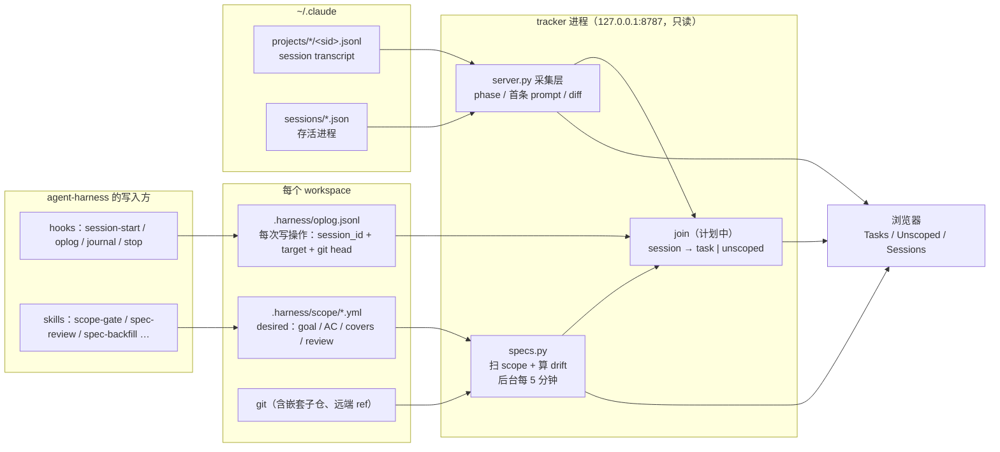
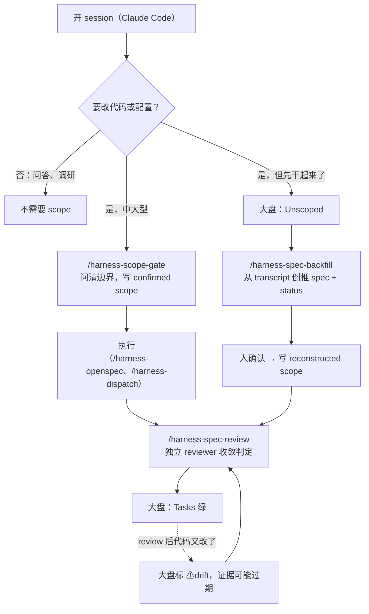

# harness tracker

`.harness/` 的**只读旁路大盘**。hooks 和 skills 负责写，tracker 只读，不做任何判断。

它回答四个问题：

1. 我承诺过哪些任务（spec）？
2. 每个任务做到哪了（status）？
3. 有没有证据（evidence）？
4. 哪些工作根本没有 spec（unscoped）？

它不是实时监控。「session 正在跑什么」只是辅助信息，主视角是 spec。

```bash
bin/harness tracker            # 启动大盘，打开 http://127.0.0.1:8787
bin/harness tracker scan       # 只重建 scope 快照
bin/harness doctor             # 包括 scope YAML 校验
```

**新版设计图（workspace → session → 任务，[x]/[ ] 摘要）：[`static/design.html`](static/design.html)，大盘起来后访问 `/design`。** 它取代下文 §6 的三 tab 方案，对应实现待做。
设计细节和待拍板项见 [`docs/tracker-design.md`](../docs/tracker-design.md)。思路讲解在 `/deck`。

---

## 1. 为什么要有它

同时开十几个乃至上百个 session 时，靠看对话来判断「做完没有」行不通。

判断标准只有一条：**事先写下的验收条件（AC），加上可核对的证据**。这和 K8s 是同一个思路：

- scope 文件是 desired state
- 证据和 git 是 observed state
- 两者之差是 diff，人只需要处理 diff

DESIGN.md 原则一说「判断不挂事件」，所以 `/harness-spec-review` 是纯 pull：不会有 hook 替你发现「有 scope 没收敛」。tracker 就是这个 pull 的入口，而且需要它的证据就在本仓库里：

- `docs/scope-and-spec-gate-design.md` 记录：一个真实 workspace 两天内攒了 15 个 scope，其中 11 个从没跑过 review。
- 2026-10-12 在同一个 workspace 实测：23 个 session 里 0 个挂到了 scope 上；6 个通过 review 的 scope 中，有 4 个在 review 之后代码又改过。

## 2. 架构



硬约束：

- **只读**：不写 scope，不改仓库，不调 LLM。唯一的例外是 `/api/recap`，只有你在页面上点开某个 session 时才调用一次 Haiku。
- **写 scope 的只有 skill**，而且写之前要人确认。
- **不建中心数据库**：数据都来自各 workspace 的 `.harness/` 和 `~/.claude/`。运行时缓存放在 `~/.harness/tracker/`，删掉不丢任何东西。
- **仓库里不放数据**：本目录只有代码和 mock，真实快照和 recap 都在 `~/.harness/tracker/`。

## 3. 跑在哪、怎么配

| 项 | 值 |
|---|---|
| 启动 | `bin/harness tracker [--port N]`。不常驻，没有 launchd |
| 地址 | `http://127.0.0.1:8787`，只监听 loopback |
| 依赖 | python3 stdlib、PyYAML（解析 scope）、本机 `git`。recap 功能需要 PATH 里有 `claude` |
| 配置 | `~/.harness/config.yml` 的 `tracker:` 段，缺省值见 `config.py` |
| 运行时数据 | `~/.harness/tracker/`：`snapshot.js`（scope 快照）、`state/goals.jsonl`（recap 记录）、`state/sidecar/`（旁路 Haiku 的固定 cwd，采集时按它把自己过滤掉） |
| 环境变量 | `HARNESS_TRACKER_PORT`、`HARNESS_TRACKER_HOME` |

```yaml
# ~/.harness/config.yml
tracker:
  roots: [~/work]         # 在这些目录下找 .harness/scope/
  port: 8787
  scan_interval_s: 300
```

## 4. workspace 里存什么、怎么组织

以一个已接入的 workspace（`cre6630-infra`）为例。`.harness/` 由 `harness init --local-ignore` 加进 `.git/info/exclude`，所以不会给公司仓库带来任何 tracked change。

```
<workspace>/.harness/
├── project.yml              # 项目边界：权威入口、STATE 上限、archive 目录（/harness-onboard）
├── STATE.md                 # 当前有效结论，≤ 8000 字符（/harness-compact 收敛）
├── journal/YYYY-MM-DD.jsonl # 每轮结束追加一条，是 STATE 的 WAL（Stop hook 写入）
├── oplog.jsonl              # 每次写操作一条：session_id / tool / target / cwd / git{branch,head,dirty} / agent
├── scope/                   # ★ tracker 的主数据源：一个任务一个文件
│   └── <slug>.yml           #   status: confirmed（事前确认）| reconstructed（事后补登）
├── backfill-drafts/         # /harness-spec-backfill 的草稿，确认前放这里，tracker 不读
├── pipeline/<slug>.yml      # 大需求拆分后的阶段串联（/harness-req-split，可选）
├── dispatch/                # 并行派活的过程产物（/harness-dispatch）
└── archive/YYYY-MM-DD/      # 被收敛或推翻的内容（git mv 进来，不 rm）
```

### scope 文件

```yaml
name: api-rate-limit                   # = 文件名，workspace 内唯一
status: confirmed | reconstructed      # 事前确认 vs 事后补登，大盘上分开统计
goal: >                                # 要达成什么
non_goals: [...]                       # 明确不做的事
acceptance_criteria:                   # ★ 每条都要能判 PASS/FAIL
  - text: ...
    inferred: false                    # 补登时：这条 AC 是不是 agent 推断出来的
    verify: "pytest tests/test_rl.py"  # 可选：能自动跑的验证命令（给将来的 /verify 用）
covers:                                # 允许改哪些路径；同时用于计算 drift 和判断 session 归属
  - src/ratelimit/                     #   普通写法：相对 workspace
  - {repo: sub-repo, ref: origin/main, paths: [lib/]}   # 嵌套仓库写法，锚定远端 ref
risk_budget: ...
confirmed_at: <ISO>
review:                                # /harness-spec-review 写
  status: CLEARED | NOT_CLEARED | DONE_WITH_CONCERNS
  reviewed_at: <ISO>
  concerns: [...]
ac_results:                            # 每条 AC 的判定和证据（backfill 或将来的 /verify 写）
  - {ac: 0, verdict: PASS|FAIL|UNKNOWN, source: rechecked|transcript_claim, evidence: ..., commit: <sha>}
origin:                                # 只在 reconstructed 时出现
  sessions: [<sid>]
  intent_quotes: [T20, T42]            # goal 依据的人类回合号
scope_changes: [...]                   # 执行过程中范围改过几次
```

组织规则：

- **一个可以独立判 PASS/FAIL 的交付对应一个文件**。大需求先用 `/harness-req-split` 拆开。
- **slug 用「对象-动作」的形式**，不要用日期或 ticket 号。
- **`covers` 写到文件或小目录**。`docs/` 这种宽目录会把无关提交都算成 drift。
- **嵌套仓库要写 `{repo, ref, paths}`**。本地 checkout 和 worktree 可能落后于远端。
- **完成了不删**。review 停在 CLEARED 即可；过期的由 `/harness-compact` 用 `git mv` 移进 `archive/`。
- `harness doctor` 会校验所有 scope：YAML 解析失败报 FAIL，缺字段或 status 值非法报 WARN。

## 5. 日常怎么工作



### 配合的 skill

| 想做的事 | skill | 状态 |
|---|---|---|
| 新项目接入这套机制 | `/harness-onboard` | ✅ |
| 开工前把边界问清楚，写 scope | `/harness-scope-gate` | ✅ |
| 大需求拆成多个能独立验收的 scope | `/harness-req-split` | ✅ |
| 单个 change 的任务分解和进度 | `/harness-openspec`（不在本仓库） | ✅ |
| 把【下一步】清单并行派出去做 | `/harness-dispatch` | ✅ |
| 判断一个 scope 做完没有 | `/harness-spec-review` | ✅ |
| 对改动做多角度交叉核查 | `/harness-cross-verify` | ✅ |
| 收敛 STATE.md、归档过期内容 | `/harness-compact` | ✅ |
| **没走流程的 session，事后补一个 scope** | `/harness-spec-backfill` | 🟡 草案，试跑过 1 次 |
| 回来时看某个 session 做到哪了（给人读） | `/session_recap`（不在本仓库；它的提取器就是本目录的 `session_recap.py`） | ✅ |
| 跑 AC 的 `verify:` 命令，写 `ac_results` | `/verify` | ⚪ 只有设计 |
| 把 session 显式绑定到任务 | `/task` | ⚪ 只有设计 |

### tracker 读取的 hook 产物

| hook | 时机 | tracker 用它做什么 |
|---|---|---|
| `harness-oplog.py` | 每次写操作之后（subagent 的写操作也记） | 判断 session 属于哪个 task 的第一依据 |
| `harness-journal.py` | 每轮结束 | 暂时不用 |
| `harness-session-start.py`、`harness-prompt-contract.py`、`harness-stop-contract.py` | — | 不读 |

## 6. 大盘显示什么

顶部一行汇总：`Tasks 15 · 待验证 x · ⚠drift y · Unscoped n · 待你输入 k`

| Tab | 一行是什么 | 列 | 回答的问题 | 状态 |
|---|---|---|---|---|
| **Tasks**（默认） | 一个 scope | workspace · task · confirmed/reconstructed · review · AC 通过/总数 · drift · 关联 session · 最近活动 | 承诺的事做到哪了？哪些证据已经过期？ | ⚪ 计划中，目前用 `/deck` 第 10 页看快照 |
| **Unscoped** | 一个 workspace 下的一组无 spec session | 首条 prompt · 改了哪些文件 · diff · phase · 可复制的 `/harness-spec-backfill <sid>` | 哪些工作没有 spec？ | ⚪ 计划中 |
| **Sessions** | 一个 session | phase（running / needs_input / done / stale / exited）· 时长 · ctx · 最后动作 · recap | 哪个卡住了？哪个在等我？ | ✅ 就是现在的首页 |

点开一个 task 能看到：每条 AC 的判定和证据、drift 涉及的提交、关联的 session（可以看 recap）、Framing 质量提示（AC 不可执行、cover 太宽、YAML 解析失败）。

**session 怎么归到 task 上**：按下面的顺序找，命中就停。页面上会显示用的是哪一条依据。

1. `oplog.jsonl` 里，这个 session 写过的 target 落在某个 scope 的 `covers` 里。
2. 这个 session 读写过 `.harness/scope/<slug>.yml`，或者 prompt 里提到了 slug。
3. 都没有，就归到 Unscoped。

## 7. 能不能依赖（2026-10-12）

| 部件 | 状态 | 能不能依赖 |
|---|---|---|
| scope 格式、scope-gate、spec-review | 用了两个月 | ✅ |
| oplog、journal、hooks | 一直在跑；单个 workspace 已有 4 万行 | ✅。oplog 没有轮转 |
| Sessions 视图（`server.py`） | 在真实数据上验证过：23 个 session，一次采集约 110ms | ✅ 可以用来看 |
| scope 快照（`specs.py`）、`/deck` | 能跑，扫一次约 8s，有后台刷新 | 🟡 drift 会受宽 cover 干扰 |
| `harness doctor` 的 scope 校验 | 能跑，目前报出 4 个 YAML 解析失败 | ✅ |
| 目标自动提炼（`goal_tracker.py` 在 prompt 和状态跳变时调 Haiku） | 还在跑 | 🟡 计划删除（design D2），只保留按需 recap |
| Tasks / Unscoped 视图、join、`/api/tasks` | 只有设计 | ⚪ |
| `/harness-spec-backfill` | 草案，试跑过 1 次 | ⚪ 产出要人工核对 |
| `/task`、`/verify`、状态栏 | 只有设计 | ⚪ |

## 8. 文件

```
tracker/
├── README.md          # 本文件
├── CONTRACT.md        # HTTP API 契约（/api/state、/api/goals、/api/recap、/data/snapshot.js、/deck）
├── config.py          # 路径与配置：数据在 ~/.harness/tracker/，配置在 ~/.harness/config.yml
├── server.py          # HTTP + session 采集（原 claude_monitor）
├── goal_tracker.py    # recap 和目标提炼（旁路 Haiku 调用）
├── specs.py           # scope 扫描、drift、校验
├── session_recap.py   # transcript 骨架提取器（recap 和 backfill 共用）
└── static/
    ├── index.html     # 大盘（目前是 Sessions；加 ?mock=1 用 dev/ 的假数据）
    ├── deck.html      # 思路讲解
    └── dev/mock_*.json
```
